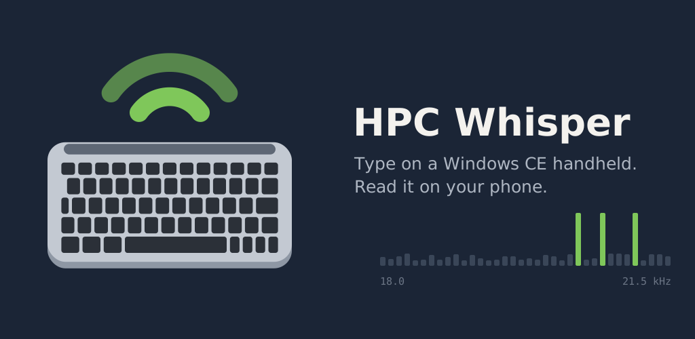

# Whisper Tools

*Formerly HPC Whisper.*

Type on a Windows CE handheld PC and the text goes straight into any app on your
phone (an email in Gmail, a message, a note), with Tab, the arrows and Ctrl+C,
V, X, Z. Send files both ways, and see the phone's screen on the handheld (the
picture remote). It all travels as sound: silent tones above 20 kHz for typing,
a soft hiss for files and the remote. No cable, no network, no extra hardware.

Made on, and for, the HP Jornada 720. Created by Kyriakos Christodoulou.

## Get it

- **Android: Whisper Tools.** Install `Whisper-Tools.apk` from the
  [latest release](../../releases/latest) and follow the setup steps. To type,
  switch to the Whisper Tools keyboard in any app. For files and the remote, tap
  **Connect**. To send a file to the handheld, use **Share → Whisper Tools** in
  any app. The app has no internet access.
- **The helper (optional).** Turned on once in the phone's accessibility
  settings, it lets the handheld press Send (Alt+S), Back, Home and Recent
  apps, and tap through the remote. It acts only on what you ask from the
  handheld.
- **iPhone, or any phone: the receiver page** in the browser,
  <https://kiriakoschristodoulou-netizen.github.io/hpc-whisper/>, with Copy and
  Share. It reads the Classic format (on the handheld: Settings, Typing format,
  Classic). *Apple does not let keyboards use the microphone at all, so an
  iPhone keyboard is impossible.*
- **Handheld:** `Whisper-Tools-32.zip` from the same release. Copy the folder
  inside it to the handheld and run `WhisperTools.exe`. Its home screen has a button for each tool.

## Which handhelds

The program is built for **ARM processors** running **Windows CE 3.0 or later**
(Handheld PC 2000, and Pocket PC 2000 onwards).

| | |
| --- | --- |
| Tested | HP Jornada 720 |
| Should work | HP Jornada 728, NEC MobilePro 900/900c, other ARM handhelds with Windows CE 3.0+; ARM Pocket PCs (the layout is made for wide screens, so it is cramped in portrait) |
| Will not run | MIPS and SH3 machines: HP Jornada 680/690, NEC MobilePro 770/780/800, Casio Cassiopeia and others. The sound format is open, so a version for them can be written |
| Unknown | Handheld PC Pro (Windows CE 2.11) on ARM |

Every machine's speaker is different: run the link check (Alt+K) and see the Link screen. In Classic, if the phone reads nothing, try a lower
band, Slow, or more volume; if you can hear the tones, try a higher band or less
volume. Please report what works on yours.

## Use

The handheld program opens on a home screen with a button for each tool (tap one, or press 1 to 6; Alt+1 to Alt+5 from anywhere, Alt+0 back home):

| Screen | What |
| --- | --- |
| Type | Type, and it goes to the phone. The status line shows what the phone has confirmed. |
| Files | The handheld's files: Enter opens a picture, text or WAV sound; S sends a file to the phone. Files from the phone arrive in `\My Documents\Whisper Tools`. |
| Remote | The phone's screen in 16 greys: zoom view first, Alt+Z for the whole screen. Tap the picture to tap the phone. |
| Link | Sound, microphone rate, the phone, and each channel's speed; Alt+K checks the link. |
| Settings | Format 3 or Classic, the silent channel, files fast or silent, loudness. |

The program's own shortcuts are on Alt (Alt+S Send, Alt+B Back, Alt+H Home
screen, Alt+W Recent apps, Alt+N new page, Alt+Q quit), so every Ctrl key reaches
the phone.

**Speeds** (format 3): typing on the silent channel, 0.8 kbit/s (narrow,
inaudible) or 2 kbit/s (wide); files and the remote's screen on the fast
channels, about 7 to 12 kbit/s each way. A photo fitted to the handheld's screen
takes 20 to 40 seconds; a new phone screen in the remote 5 to 15 seconds, a
small change about a second.

**Lost pieces fill themselves in.** The phone confirms what has arrived and the
handheld repeats only what is missing. Files go in numbered 1 KB packets; the
receiver asks for any that failed. If something still goes wrong, the app's
**Record 30 seconds** button saves what the phone hears, to send for diagnosis.

## Host the receiver yourself

The receiver is `index.html`, `modem.js`, `manifest.json`, `sw.js` and the
`icons/` folder. Put them on any web space that serves **https** (GitHub Pages,
Netlify, Cloudflare Pages, your own site); the microphone works only over https.
Nothing runs on the server. The same files are in the handheld download, under
`source/web`.

## How it works

Format 3 ([docs/FORMAT3.md](docs/FORMAT3.md)) is OFDM: many carriers at once,
each carrying 1 to 3 bits in how its phase turns from one 12.5 ms symbol to the
next, so nothing needs calibrating by hand. Four channels: silent up (20.0–21.2
kHz, 200 Hz apart, so the Jornada's "ghost" 900 Hz below every tone falls
between carriers), silent down, fast up (1–19 kHz) and fast down (0.5–12 kHz). A
link check measures every carrier and sends back a map of bits per carrier.
Frames carry Reed–Solomon codes interleaved across carriers and a CRC. The
handheld's side is whole-number Pascal (its processor has no floating point);
the phone's is Java; the two are tested against each other through a simulated
room, including the Jornada's microphone running at 43,230 samples/s while it
says 44,100.

The Classic format ([docs/FORMAT.md](docs/FORMAT.md)) is kept for older phone
apps and the receiver page: 16 tones 100 Hz apart, 4 bits per tone.

## Files

| Folder | What |
| --- | --- |
| `/` | the receiver page (served by GitHub Pages) |
| `android/` | the Android app: keyboard, files, remote, helper (Java) |
| `handheld/` | the handheld program (Free Pascal for Windows CE, ARM) and its download |
| `docs/` | the sound formats and the artwork |
| `tests/` | both formats checked across Pascal, Java and JavaScript, with noise, echoes, dropouts and lost packets (`tests/w3` for format 3) |

The Android app is built by GitHub on every change (see `.github/workflows`).
Its signing key is kept in the repository on purpose, so each new build
installs over the old one.
